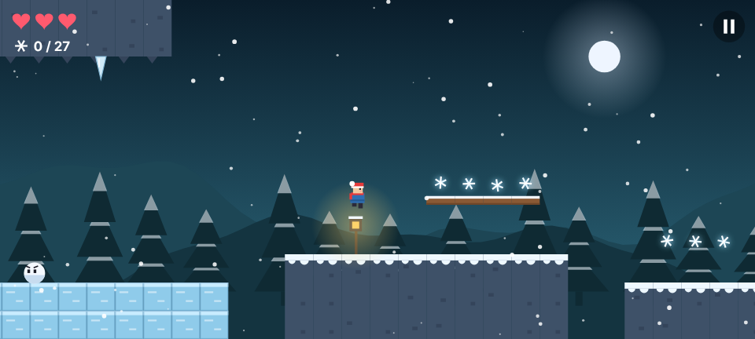

# ENS Developer · Kişisel site ve uygulamalar

Web sitem, tarayıcı oyunlarım ve telefon uygulamalarım bu depoda.

## 🏮 Ayaz Ata'nın Feneri

Hikâyeli 2D platform oyunu, bir Nardugan masalı. Karakoncolos, Ayaz Ata'nın fenerindeki üç yıldız parçasını çalmış; Bora olarak Köy Yolu, Buz Ormanı ve Karakoncolos'un Mağarası'ndan geçip parçaları geri topluyorsun.

- 3 bölüm, bölüm arası hikâye sahneleri, Karakoncolos ile kapışma
- Kar topu düşmanları, düşen buz sarkıtları, kaygan buz, kayıt fenerleri
- Dokunmatik tuşlar (telefon) ya da klavye (← → ve Boşluk)

<!-- ENS:TANITIM -->
### 🎬 Tanıtım

Tam kalitede izlemek için görsele tıkla · MP4, 47 saniye

<!-- /ENS:TANITIM -->

## 🍲 Yemek Tarifleri

Telefona özel tarif uygulaması: 12 hazır Türk tarifi, kişi sayısına göre otomatik hesaplanan malzemeler, adım adım zamanlayıcı, favoriler, kendi tariflerini ekleme. İnternetsiz çalışır.

<!-- ENS:TANITIM -->
### 🎬 Tanıtım

Tam kalitede izlemek için görsele tıkla · MP4, 34 saniye

<!-- /ENS:TANITIM -->

## 🎮 Tarayıcı oyunları

Yılan, Pong, Tic Tac Toe, Taş Kâğıt Makas ve Eşleştirme: [oyunlar sayfası](https://enskygr234.github.io/ensdewloper.github.io/oyunlar.html)

## 📁 Depoda ne nerede?

| Klasör / dosya | İçerik |
|---|---|
| `index.html` | Ana sayfa |
| `hakkımda.html` | Hakkımda sayfası |
| `oyunlar.html` | Tarayıcı oyunları |
| `ayaz-feneri/` | Ayaz Ata'nın Feneri oyunu |
| `tarifler/` | Yemek Tarifleri uygulaması |
| `.github/workflows/` | Siteyi yayınlayan ve APK'ları derleyen otomatik işler |

## 📱 APK'lar nasıl oluşuyor?

`ayaz-feneri/` ya da `tarifler/` klasöründe bir değişiklik yüklendiğinde GitHub Actions uygulamayı Capacitor ile Android'e çevirir ve APK'yı **Releases** sayfasına koyar. Elle bir şey yapmaya gerek yok.

APK'yı ilk kurarken telefon "bilinmeyen kaynaklardan yükleme" izni isteyebilir.

---

📩 [ensygk115@gmail.com](mailto:ensygk115@gmail.com) · [GitHub profilim](https://github.com/Enskygr234)

<!-- ENS:ALT -->
---

**❄️ ENS Developer'ın diğer projeleri**

🆕 Yeni: [Korku Modu](https://github.com/Enskygr234/korku-modu) · [Oyuncu Merkezi](https://github.com/Enskygr234/oyuncu-merkez) · [İndirim Avcısı](https://github.com/Enskygr234/indirim-avcisi)

🎮 Oyunlar: [Mahalle](https://github.com/Enskygr234/mahalle) · [Ayaz Ata'nın Feneri](https://github.com/Enskygr234/ensdewloper.github.io/tree/main/ayaz-feneri) · [Kayıp Fener](https://github.com/Enskygr234/kayip-fener) · [Son Kış](https://github.com/Enskygr234/son-kis) · [Ayazle](https://github.com/Enskygr234/ayazle) · [Buz Kırıcı](https://github.com/Enskygr234/buz-kirici)

[🌐 Bütün projeler](https://enskygr234.github.io/ensdewloper.github.io/) · [👤 GitHub profilim](https://github.com/Enskygr234)

Kış gelir, kod yazılır.

<!-- /ENS:ALT -->
